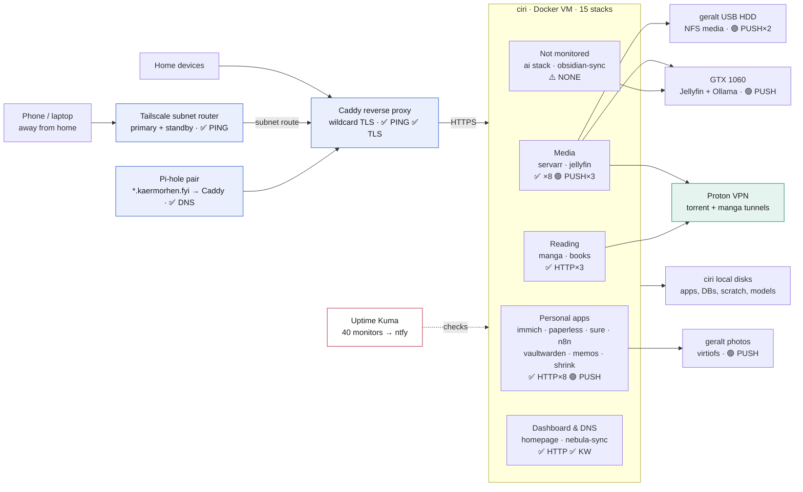
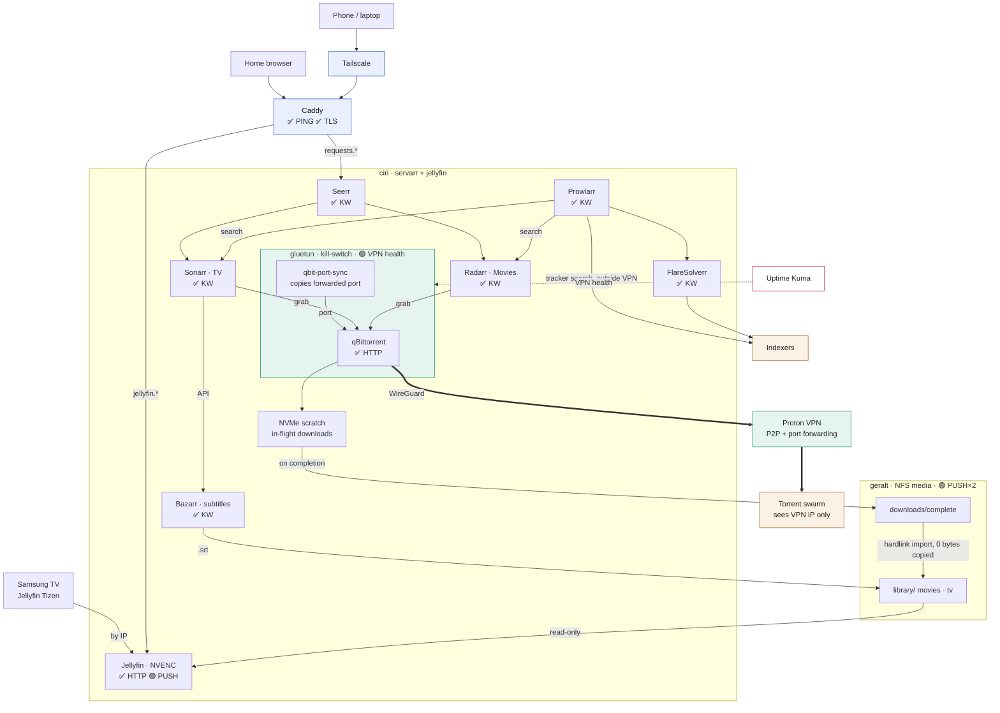
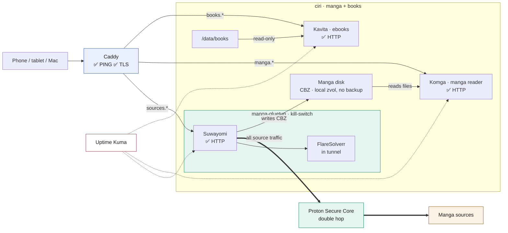
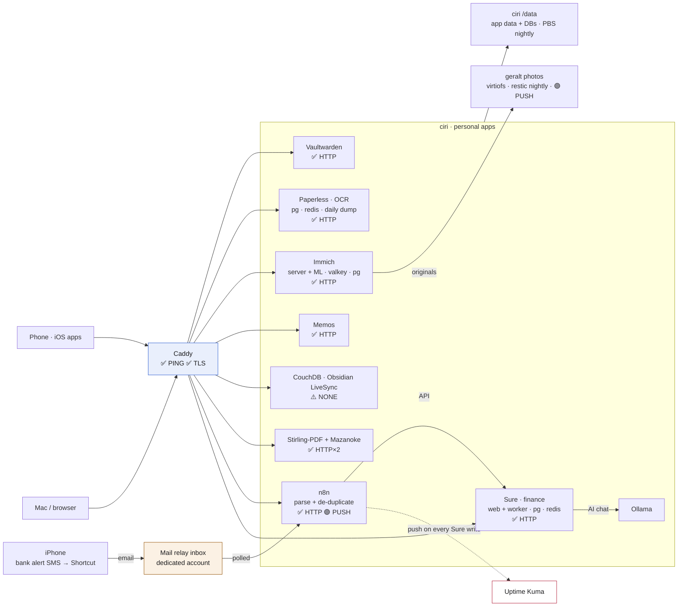
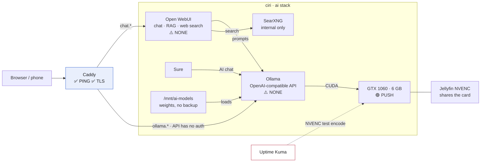
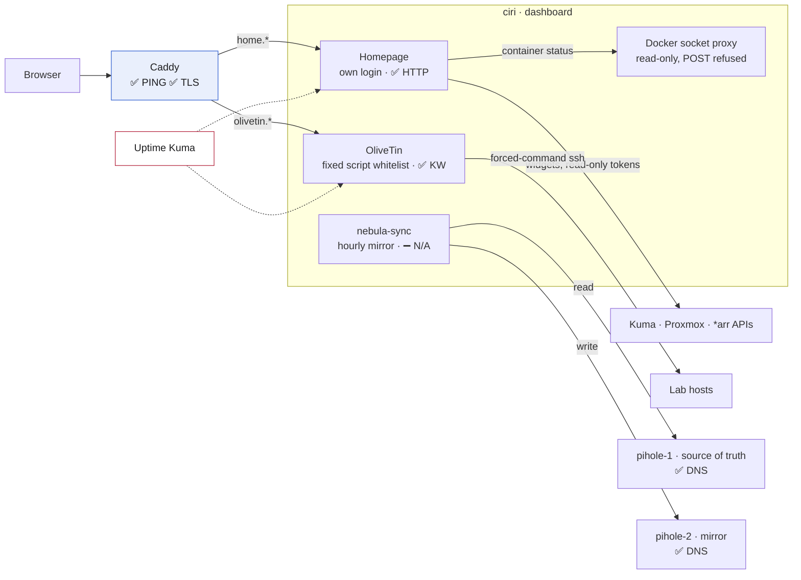
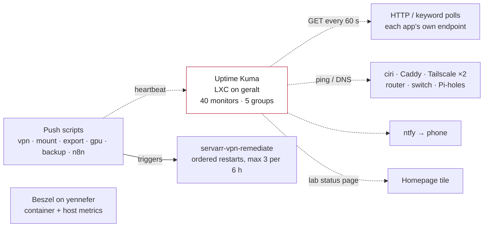

# ciri services map

Every service on **ciri** (Docker VM 150 on geralt): how it connects, and which
Uptime Kuma check watches it. This is a sharing and presenting overview. The
as-built detail lives in [docker-vm.md](docker-vm.md), each stack's README
under [`configs/ciri/`](../configs/ciri/), and [uptime-kuma.md](uptime-kuma.md).

Nothing on ciri is exposed to the internet:
- **On the LAN**, Caddy serves HTTPS names (`*.kaermorhen.fyi`) with one wildcard certificate.
- **Away from home**, Tailscale routes into the LAN.

IPs, keys, push URLs and credentials are left out on purpose.

Monitor roster as of **2026-11-10**, read from Kuma's live `lab` status page:
**40 monitors in 5 groups**.

**Kuma badges used below**

| Badge | Meaning |
|---|---|
| ✅ `HTTP` / `KW` / `PING` / `DNS` / `TLS` | polled by Kuma (KW = keyword must appear in the page) |
| 🟣 `PUSH` | functional heartbeat sent by a script (tests real behaviour, not just "is it up") |
| ⚠️ `NONE` | not monitored, a gap |
| ➖ `N/A` | nothing to check (no port, batch job) |

**Contents**
1. [Overview](#1-overview)
2. [Media: request → download → stream](#2-media-request--download--stream)
3. [Reading: manga and books](#3-reading-manga-and-books)
4. [Personal apps](#4-personal-apps)
5. [AI](#5-ai)
6. [Dashboard and DNS sync](#6-dashboard-and-dns-sync)
7. [Monitoring](#7-monitoring)

---

## 1. Overview

| Stack | What it does | Kuma |
|---|---|---|
| [servarr](../configs/ciri/servarr/README.md) | Seerr, Sonarr, Radarr, Prowlarr, Bazarr, FlareSolverr, and qBittorrent behind gluetun | ✅ HTTP×7, 🟣 VPN health |
| [jellyfin](../configs/ciri/jellyfin/README.md) | Media server, NVENC on the GTX 1060, library read-only | ✅ HTTP, 🟣 GPU health |
| [manga](../configs/ciri/manga/README.md) | Suwayomi (in its own Secure Core tunnel) and the Komga reader | ✅ HTTP×2 |
| [books](../configs/ciri/books/README.md) | Kavita ebook reader | ✅ HTTP |
| [immich](../configs/ciri/immich/README.md) | Photos, ML (CPU), valkey, postgres | ✅ HTTP |
| [paperless](../configs/ciri/paperless/README.md) | Documents with OCR, postgres, redis, daily dump | ✅ HTTP |
| [sure](../configs/ciri/sure/README.md) | Personal finance: web, worker, postgres, redis, daily dump | ✅ HTTP (via Caddy) |
| [n8n](../configs/ciri/n8n/README.md) | Workflow engine for the bank SMS → Sure pipeline | ✅ HTTP, 🟣 ingest push |
| [vaultwarden](../configs/ciri/vaultwarden/README.md) | Password manager | ✅ HTTP |
| [memos](../configs/ciri/memos/README.md) | Quick notes | ✅ HTTP |
| [obsidian-sync](../configs/ciri/obsidian-sync/README.md) | CouchDB for Obsidian LiveSync | ⚠️ none |
| [shrink](../configs/ciri/shrink/README.md) | Stirling-PDF and Mazanoke | ✅ HTTP×2 |
| [ai](../configs/ciri/ai/README.md) | Ollama, Open WebUI, SearXNG | ⚠️ none (GPU push only) |
| [homepage](../configs/ciri/homepage/README.md) | Homepage dashboard, OliveTin, Docker socket proxy | ✅ HTTP, ✅ KW |
| [nebula-sync](../configs/ciri/nebula-sync/README.md) | Mirrors pihole-1 to pihole-2 every hour | ➖ by design |

---

## 2. Media: request → download → stream

- **Kill-switch:** qBittorrent has no network of its own, only gluetun's. When the tunnel is down there is no route out, so traffic can't fall back to the home IP.
- **Rotating port:** Proton changes the forwarded port. Every 30 s, qbit-port-sync copies it into qBittorrent and never writes 0.
- **Hardlink contract:** `downloads/` and `library/` share one filesystem, so an import is an instant link with no copy.
- **Missing-mount guard:** if the NFS media share is missing, the media containers refuse to start. They never write to the VM's own disk instead.
- **VPN health check:** it makes a real request from inside the tunnel. A leak alerts immediately, other failures alert after 3 runs, and stranded or orphaned clients are fixed by ordered restarts (at most 3 per 6 h, never on a leak).

---

## 3. Reading: manga and books

- **Separate tunnel:** the manga tunnel is a second gluetun. If it fails, the torrent tunnel is unaffected, and the reverse is also true.
- **Readers stay up:** Suwayomi and Komga only share a directory, never a network, so Komga and Kavita still work when the VPN is down.
- **Tunnel alarm:** Suwayomi is only reachable through the tunnel's port, so a red Suwayomi monitor means the manga tunnel is down.

---

## 4. Personal apps

- **Bank SMS → Sure:** an iPhone automation forwards each bank SMS to a dedicated mail inbox. n8n polls it, parses and de-duplicates, then writes to Sure's API. Every write sends a Kuma heartbeat, and the monitor goes red after 48 h of silence.
- **Backups:** app data and databases on `/data` go to PBS nightly. Paperless and Sure also keep daily `pg_dump`s. Photo originals live on geralt and are backed up nightly with restic.
- **HTTPS matters:** Obsidian mobile, the n8n login and Vaultwarden all need real TLS, which they get from Caddy's wildcard certificate.

---

## 5. AI

- **Shared GPU:** a loaded model holds VRAM until keep-alive frees it. gpu-health counts a failed encode as contention, not a fault, while VRAM is busy.
- **Gap:** Ollama and Open WebUI have no Kuma check yet, so a dead container is only noticed when you try to use it.

---

## 6. Dashboard and DNS sync

- **Read-only dashboard:** the Docker socket proxy rejects writes, and every API token Homepage uses is read-only.
- **OliveTin:** runs only whitelisted scripts, over ssh keys locked to a single forced command.
- **DNS changes go on pihole-1 only.** pihole-2 is overwritten every hour.

---

## 7. Monitoring

### Active monitors for ciri

| Group | Monitor | Type | Checks | A green result proves |
|---|---|---|---|---|
| media-stack | jellyfin | ✅ HTTP | `:8096` | Media server answers |
| media-stack | qbittorrent | ✅ HTTP | `:8080` (via gluetun) | qBit is alive, and so is gluetun, since the port is published through it |
| media-stack | prowlarr · sonarr · radarr | ✅ KW | `/ping` → `OK` | Each *arr app is up |
| media-stack | bazarr | ✅ KW | `:6767` → `Bazarr` | The UI renders |
| media-stack | seerr | ✅ KW | `/api/v1/status` → `version` | The request API answers |
| media-stack | flaresolverr | ✅ KW | `:8191` → `FlareSolverr is ready` | The solver is ready |
| media-stack | servarr vpn health | 🟣 PUSH | every 180 s | Real egress is the VPN IP, the tunnel is up, port-fwd is synced, the client isn't orphaned |
| media-stack | media mount | 🟣 PUSH | 360 s | ciri can actually read the NFS media share |
| reading-stack | komga · kavita | ✅ HTTP | health endpoints | Readers are up |
| reading-stack | suwayomi | ✅ HTTP | `:4567` with credentials | Suwayomi is up, so the manga tunnel is up |
| ciri | ciri-ping | ✅ PING | VM | The VM is alive |
| ciri | gpu health | 🟣 PUSH | 360 s | A real NVENC encode works inside Jellyfin |
| ciri | immich · paperless · memos · pdf-stirling | ✅ HTTP | app ports | Each app answers |
| ciri | image-mazanoke | ✅ HTTP | basic auth | The real page is served past basic auth |
| ciri | vaultwarden | ✅ HTTP | `/alive` | Vault answers, checked directly and not through the proxy |
| ciri | sure | ✅ HTTP | `https://sure.kaermorhen.fyi` | Finance app through Caddy |
| ciri | n8n | ✅ HTTP | `/healthz` | Workflow engine is up |
| ciri | n8n-hdfc-ingest | 🟣 PUSH | 48 h window | The bank pipeline wrote to Sure recently |
| ciri | home | ✅ HTTP | `:3010`, 2xx–3xx | Dashboard is up (its login redirect counts as up) |
| ciri | olivetin | ✅ KW | `OliveTin` | Script runner renders |
| infra | proxy-caddy / proxy-tls | ✅ PING / TLS | Caddy, cert | Proxy is up, certificate valid and not expiring |
| infra | media-export | 🟣 PUSH | 60 s, from geralt | geralt is exporting the media disk over NFS |
| infra | photos-backup | 🟣 PUSH | 25 h window | The nightly photo backup ran |

### Not covered by Kuma

- ⚠️ **Ollama, Open WebUI:** no check yet. Planned: keyword check on Ollama, HTTP on Open WebUI.
- ⚠️ **CouchDB (obsidian-sync):** no check yet. Planned: `/_up` with basic auth.
- ➖ **nebula-sync:** by design. No port and an hourly batch job, so a failure shows up as Pi-hole drift.
- ➖ **gluetun, qbit-port-sync, manga-gluetun:** covered indirectly by the qbittorrent and suwayomi checks and the VPN-health push.
- ➖ **SearXNG, socket proxy, databases, redis/valkey, ML workers:** internal only. Covered through their parent app's check, with container state in Beszel.
- ➖ **Uptime Kuma itself:** runs on geralt and goes down with it. Beszel on yennefer covers that host.
